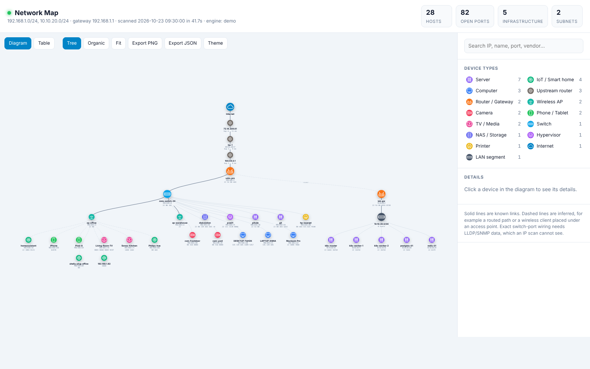

# netmap

`netmap` finds every device on your network, scans each one for open ports and works out
what it probably is. The result is an interactive diagram in a single HTML file.



* **Zero dependencies.** It runs on the Python 3.9+ standard library alone. If `nmap` is
  installed, netmap uses it automatically for OS fingerprinting and service versions.
* **Discovery** combines ICMP sweep, TCP probes (a RST proves a host is up), the ARP cache,
  UPnP/SSDP, and traceroute to the internet.
* **Names** come from reverse DNS, mDNS (Apple, Linux, IoT) and NetBIOS (Windows/Samba).
  Vendors come from the MAC OUI database.
* **Fingerprinting** uses open ports, service banners, HTTP page titles, TTL, vendor and
  hostname to classify each device as one of: router, firewall, switch, wireless AP,
  server, NAS, hypervisor, computer, phone, printer, camera, TV/media, or IoT.
* **The diagram** has a tidy tree view and a physics view, search, type filters, a
  click-for-details panel, a sortable table view, dark/light themes, and PNG/JSON export.

## Install

netmap has no dependencies, so you don't need to install it. Clone it and run it from the folder:

```bash
git clone https://github.com/mrbc42/Netmap.git
cd netmap
python3 -m netmap demo --open
sudo python3 -m netmap scan
```

When the scan finishes, open `network-map.html` (in the same folder) in your browser. `--open` is left off
the `sudo` command because a browser started as root often fails to open.

To update later, run `git pull` inside the folder.

### Installing a `netmap` command (optional)

```bash
pip install .
```

On Debian, Ubuntu and other distributions that use PEP 668, that command fails with
`error: externally-managed-environment`. Use pipx instead, which installs into its own environment:

```bash
sudo apt install pipx
pipx install .
pipx ensurepath          # then open a new terminal
netmap demo --open
sudo $(which netmap) scan   # sudo doesn't see your personal PATH
```

Don't use `--break-system-packages`. It works, but it can break your system Python.

### Optional extras

```bash
netmap offline           # cache the diagram JS so reports work with no internet
netmap oui-update        # full MAC vendor database (~50k vendors)
```

Without an installed command, run these as `python3 -m netmap offline` and so on.

## Use

```bash
netmap demo --open                       # preview with a sample network, no scanning
sudo netmap scan --open                  # scan every network this machine can see
sudo netmap scan 192.168.1.0/24 10.0.0.0/24 -p top200
netmap scan 192.168.1.0/24 -p all -e builtin   # all 65535 ports with the built-in engine
netmap render network-scan.json -o map.html    # re-draw from a saved scan
netmap info                              # show detected interface, subnet and gateway
```

The examples below use the `netmap` command. Without it, use `python3 -m netmap` instead.

Run it with `sudo` (or as Administrator on Windows) for the best results. Root enables a
fast raw-ICMP sweep, raw traceroute, and nmap's SYN scan and OS detection. Without root it
still works: it falls back to the system `ping` and TCP connect probes.

| Option | Meaning |
|---|---|
| `-p top` / `top200` / `all` / `22,80,8000-8100` | Ports to scan. Mixes like `top,2222` are fine. |
| `-e auto\|builtin\|nmap` | Scanning engine. `auto` uses nmap when it is installed. |
| `-t 1.0` | Per-connection timeout in seconds. Raise it on slow Wi-Fi or VPN links. |
| `-c 512` | Number of simultaneous connections. |
| `--lan-only` | Only scan the main LAN. Skips container/VM bridges, VPNs and routed networks. |
| `--max-hosts 4096` | Largest range to sweep in full. Bigger ones (e.g. podman's /16) are trimmed to the /24 in use. |
| `--no-traceroute` | Skip the internet path. |
| `-o`, `-j` | HTML and JSON output paths. |

## What gets scanned

With no targets given, netmap scans **every network it finds**:

* the main LAN, which is the interface holding the default route,
* every other attached interface, including podman/docker/libvirt bridges, VPNs and extra NICs,
* private networks in the routing table that are reached through another router.

`netmap info` lists what it found. Container and VM networks are drawn hanging off this
machine, because they are reached through it. If you run netmap *inside* a container, it
can only see that container's network and prints a warning. Run it on the host instead.

## How the diagram is built

An IP scan can see subnets, the default gateway, the routed path out (traceroute) and
which hosts are infrastructure. It **cannot** see which switch port each device is
plugged into, because that requires LLDP/CDP neighbour tables or SNMP bridge MIBs from
the switches. Each subnet is therefore drawn as a *LAN segment*. If exactly one managed
switch is found, that switch becomes the hub. Links that are guesses are drawn
**dashed**. Examples are phones and IoT devices placed under a wireless AP, and a second
router reached through the main gateway.

## Extending it

* **Classification rules** are in `netmap/classify.py`: keyword regexes and port sets,
  each worth some points. Add your own, for example `(r"plex", "media", 5)`.
* **Icons** are inline SVGs in `netmap/icons.py`.
* **Scan data** is plain JSON (`network-scan.json`), so you can diff scans over time or
  feed them into other tools.

## Legal

Only scan networks you own or have permission to test.
